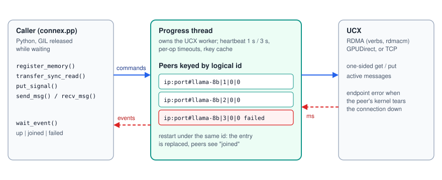
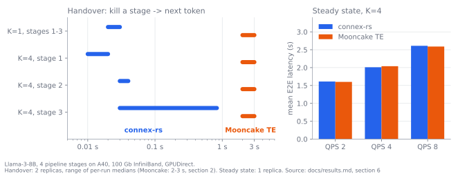

<p align="center">
  <picture>
    <source media="(prefers-color-scheme: dark)" srcset="docs/assets/connex-rs-logo-dark.svg">
    
  </picture>
</p>

<p align="center"><b>The Connex data plane: Rust over UCX, peer-death events in milliseconds, same-identity rejoin</b></p>

<p align="center">
  <a href="https://github.com/HeterInfra/connex-rs/actions/workflows/ci.yml"></a>
  <a href="LICENSE"></a>
  
  
  = 3.8 (abi3)" src="https://img.shields.io/badge/python-%E2%89%A53.8%20%28abi3%29-3776ab?logo=python&logoColor=white">
  <a href="https://pypi.org/project/connex-rs/"></a>
  <a href="https://crates.io/crates/connex-rs"></a>
  <a href="https://github.com/HeterInfra/connex"></a>
</p>

## About

connex-rs moves pipeline-step data between Connex endpoints and tells them,
within milliseconds, when a peer dies. It is a Rust crate over UCX with a
Python binding (`connex_rs`) and is the default data plane of `connex.pp` in
[Connex](https://github.com/HeterInfra/connex) on
hosts with a usable RDMA device (`CONNEX_PP_BACKEND=auto`, or force it with
`CONNEX_PP_BACKEND=connex-rs`; Mooncake Transfer Engine stays available with
`CONNEX_PP_BACKEND=mooncake`).

<p align="center"></p>

What it provides:

* **One-sided RMA on registered memory**, host or GPU (GPUDirect RDMA):
  `transfer_sync_read(url, dst, src, len)` and the rest of the TransferEngine
  surface that `connex.pp` uses, so the endpoint's design (sender stages bytes
  in a registered ring, signals, receiver does one read, ack frees the slot)
  maps one to one. Plus one-sided writes, `put_signal` (write, then a message
  that arrives only after the data is in place), and plain messages.
* **Identity-keyed peers.** A peer URL is `ip:port#model|stage|shard|replica`.
  Connections are bound to the logical id, so a stage that restarts under the
  same id and address is the same peer to everyone else: it rejoins without
  anyone else restarting.
* **Peer-failure events.** Every UCX endpoint runs with peer error handling;
  a dead process is reported in a few ms (its kernel tears the connection
  down). A heartbeat on the progress thread (default 1 s / 3 s) and per-op
  timeouts report hung or unreachable peers; those are suspicions that
  `connex.pp` confirms with a probe.
* **A dedicated progress thread.** It owns the UCX worker; callers submit
  commands and wait on completions, and the Python binding releases the GIL
  while waiting. Heartbeats and failure handling keep running while the
  inference engine holds the GIL.

## Performance vs Mooncake Transfer Engine

Same cluster and deployment: Llama-3-8B split into 4 pipeline stages on
A40 GPUs, one stage per GPU, InfiniBand between nodes, 2 pipeline replicas
with 4 steps in flight per replica (`CONNEX_PP_INFLIGHT=4`); only
`CONNEX_PP_BACKEND` differs. The steady-state and closed-loop Mooncake
numbers were re-measured in the same session as connex-rs; the Mooncake
transfer and handover numbers come from the earlier validation of the same
setup. Full tables, setup and reproduction
commands: [`docs/results.md` in the Connex repository](https://github.com/HeterInfra/connex/blob/main/docs/results.md).

<p align="center"></p>

**Raw transfers**, GPU to GPU across nodes, one-sided read of registered
GPU memory (GPUDirect RDMA):

| size | connex-rs | Mooncake TE |
|---|---|---|
| 16 KB | 8-10 µs | 9 µs |
| 1 MB | 98-106 µs | 116 µs |
| 16 MB | 1.69 ms | 2 ms |

**Serving, steady state**, trace replay, 100% goodput for both:

| load | connex-rs mean (P99) | Mooncake TE mean (P99) |
|---|---|---|
| QPS 2 | 1.61 s (5.63 s) | 1.60 s (5.61 s) |
| QPS 4 | 2.01 s (7.17 s) | 2.04 s (7.13 s) |
| QPS 8 | 2.61 s (10.01 s) | 2.59 s (10.03 s) |
| closed loop, 128 clients | 2530 tok/s | 2608 tok/s |

**Failure handling**, where the two differ:

| | connex-rs | Mooncake TE |
|---|---|---|
| peer death detected | in a few ms (UCX endpoint error) | not reported; lease + timeout + probe |
| handover, kill stage to next token (median per run) | 0.02-0.03 s at 1 step in flight, 0.01-0.83 s at 4 | 2-3 s |
| restart one killed stage under the same identity | works; the other stages keep running | breaks its peers; restart the whole chain |
| hard churn, QPS 8, without / with the resume proxy | 99.2% / 100% goodput | 99.2% / 100% |
| correctness after failover (18 kill runs) | all requests complete, 0 tokens off the argmax | same |
| 100 kill / rejoin cycles | fds, RSS, registered memory flat | not applicable |

Where connex-rs is not better: closed-loop throughput is 3% lower (not yet
profiled), its TCP path (no RDMA) is several times slower than Mooncake's, which
is why `auto` keeps Mooncake on hosts without RDMA, and individual requests
can still stall for up to about 1 s (worst request 1.03 s at 1 step in
flight, 0.92 s at 4) even though the per-run medians are far lower.

## Layout

| path | what |
|---|---|
| `csrc/cxshim.c` | C shim compiled against the system UCX (`$UCX_HOME`, else `/opt/hpcx/ucx`, else `/usr`). Rust sees only opaque pointers, so no UCX struct layout is mirrored. Callbacks only append to an event ring. |
| `src/engine.rs` | `Engine`: progress thread, registered memory, rkey cache with invalidation, get/put/put_signal, messages, peer events |
| `src/lib.rs` | `Endpoint` (single-threaded UCX endpoint keyed by `LogicalId`, heartbeat, rejoin), `Event` |
| `src/python.rs` | PyO3 module `connex_rs` (`Engine`, `Transfer`, and the step-1 `Endpoint`) |
| `src/bin/cxbench.rs` | failure-detection / rejoin benchmark (step 1) |
| `tests/` | integration tests over real UCX (threads and processes) |
| `python/rma_bench.py` | one-sided read latency/bandwidth, host or GPU, local or cross-host |
| `python/churn_peer.py` | kill/rejoin a peer under the same id N times against a live engine (leak check) |
| `python/test_binding.py` | step-1 binding smoke test |
| `bench/` | failure-detection benchmarks (detection latency, rejoin, false positives) |
| `scripts/check_release.py` | release scanner (environment-specific data, secrets), run in CI |
| `docs/assets/` | README images (SVG) |

## Install, build, test

```bash
pip install connex-rs   # prebuilt wheel: links the UCX of the build host by rpath; on
                        # RDMA/GPU hosts build from source against your UCX:
```

```bash
# Rust toolchain (rustup) and UCX with the transports you need (verbs/rdmacm
# for RDMA, CUDA for GPU memory). UCX_HOME points at its prefix.
cargo build --release
cargo test --release                       # UCX over TCP on loopback
CONNEX_RS_TEST_TLS=rc_mlx5 CONNEX_RS_TEST_IP=<IPoIB address> UCX_NET_DEVICES=<hca>:1 \
  cargo test --release                     # same tests over RDMA

# Python wheel (abi3, Python >= 3.8); links UCX by rpath, does not bundle it
pip install maturin
maturin build --release -o dist && pip install dist/connex_rs-*.whl
# backend tests over real Connex endpoints live in the Connex repository:
#   (in a Connex checkout) python -m pytest tests/test_connexrs_backend.py
python python/rma_bench.py local --ip <IPoIB address> --dev cuda:0 --peer-dev cuda:1
```

## Python API

```python
import connex_rs
e = connex_rs.Engine("llama-8b", stage=1, shard=0, replica=0,
                     listen_ip="10.0.0.2", port=51001,
                     heartbeat_ms=1000, heartbeat_timeout_ms=3000)
e.local_url                     # "10.0.0.2:51001#llama-8b|1|0|0"
e.register_memory(t.data_ptr(), t.numel())        # host or GPU memory
e.transfer_sync_read(peer_url, dst_ptr, src_ptr, n)   # 0, or < 0 on failure
h = e.put_signal(peer_url, src_ptr, dst_ptr, n, b"step 7")  # h.wait()
e.send_msg(peer_url_or_id_tuple, b"...");  e.recv_msg(timeout_ms=100)
e.wait_event(timeout_ms=100)    # {"type": "up"|"joined"|"failed", "peer": (...), "reason": ...}
e.stats()                       # endpoints, regions, rkeys, in-flight, failures ...
e.close()
```

Return codes of `transfer_sync_read` / `transfer_sync_write`: 0 ok, -2 peer
failed, -3 timeout (the connection is then closed, so no late DMA lands in
the destination), -4 invalid (e.g. no registered region at that address).

## UCX settings that matter

* `UCX_NET_DEVICES`: pin the RDMA device and its IPoIB interface
  (`connex.pp` does this automatically, `CONNEX_RS_NET_DEVICES=auto`). On
  hosts with container or VPN interfaces UCX otherwise tries those and the
  connection fails. HCA names can differ between hosts.
* Protocol: when RDMA is usable the engine sets `PROTO_ENABLE=n` on its own
  UCX configuration. UCX 1.16's protocol v2 selects software emulation for
  get/put on CUDA memory over client/server endpoints, while v1 does
  GPUDirect zero-copy. Without RDMA it keeps v2, because v1 would emulate RMA
  on CUDA memory by touching the device pointer from the CPU. An explicit
  `UCX_PROTO_ENABLE` always wins.
* `UCX_TCP_CM_REUSEADDR=y` (set by `connex.pp`): a restarted stage can listen
  on its port again at once.
* `CONNEX_RS_DEBUG=1` prints every event and failed transfer.

## Limits

* Node loss or a network partition (no RST, no ACK) is detected by the
  heartbeat or an op timeout and confirmed by the probe, not by UCX in ms.
  This path was not tested by taking a link down.
* Without RDMA (TCP), GPU memory is staged through host memory by UCX and is
  slow; host memory over TCP works as a fallback.
* One endpoint per peer pair: if two peers connect to each other at the same
  moment, one endpoint replaces the other (the rejoin path). `connex.pp`
  avoids this by linking only towards peers ordered after itself.

Measurements: [`docs/results.md`](https://github.com/HeterInfra/connex/blob/main/docs/results.md), section 6, in the Connex repository.

## Used by

[Connex](https://github.com/HeterInfra/connex), the communication library for
endpoint mobility in distributed LLM serving, installs it with
`pip install "connex-ai[rs]"` and selects it with `CONNEX_PP_BACKEND=auto`
(or `connex-rs`). Changes are listed in [CHANGELOG.md](CHANGELOG.md).

## License

Apache-2.0, see [LICENSE](LICENSE).
